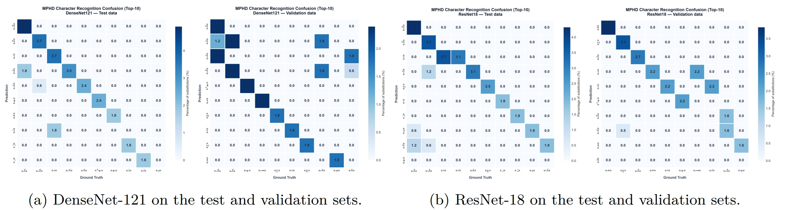

# MPHD Character and Digit Recognition Benchmark

This directory provides the official training and evaluation scripts to reproduce the Character (62 classes) and Digit (10 classes) recognition results reported in the MPHD paper (Section 4.4, Table 11). 

The benchmark evaluates two standard CNN architectures: **ResNet-18** and **DenseNet-121**.

---

## Prerequisites
1. Download the MPHD dataset from [Zenodo](https://doi.org/10.5281/zenodo.23557640) and extract it.
2. Ensure you have already generated the official `.ln` split files (`train.ln`, `val.ln`, `test.ln`) as described in the step 1.1 and 1.2 of [HTR benchmark section](https://github.com/jampour/MPHD/tree/main/benchmarks/HTR).
3. Install the required Python packages:
   ```bash
   pip install torch torchvision scikit-learn seaborn matplotlib
   ```

---

## Step 1: Setup & Configuration
1. Ensure you are in the `benchmarks/char_recognition/` directory.
2. Open both `mphd_cnn_baseline_char.py` and `mphd_cnn_baseline_digit.py` and update the `DATA_ROOT` variable to point to your extracted MPHD dataset folder:
   ```python
   DATA_ROOT = "../MPHD"  # Change this to your actual dataset path
   ```
3. Make sure the `.ln` files (`train.ln`, `val.ln`, `test.ln`) are located in the parent directory (`../`), as specified in the `TRAIN_LN`, `VAL_LN`, and `TEST_LN` variables.

*(Optional)* To change the architecture from the default ResNet-18 to DenseNet-121, modify the `MODEL_NAME` variable inside the scripts:
```python
MODEL_NAME = "densenet121"  # Or "resnet18"
```

---

## Step 2: Training the Models

### 1. Character Recognition (62 Classes)
To train the model on the 62 isolated character classes, run:
```bash
python mphd_cnn_baseline_char.py
```
*The best model checkpoint will be saved as `mphd_char62_best.pt`, and a full confusion matrix as `mphd_char62_cm.png`.*

### 2. Digit Recognition (10 Classes)
To train the model on the 10 isolated digit classes, run:
```bash
python mphd_cnn_baseline_digit.py
```
*The best model checkpoint will be saved as `mphd_digit10_best.pt`, and a full confusion matrix as `mphd_digit10_cm.png`.*

---

## Step 3: Evaluation & Error Analysis (Top-10 Substitutions)
To generate the Top-10 substitution confusion matrices (as shown in Figure 10 of the paper) for the character recognition task, run:

1. Create a folder named after your model (e.g., `ResNet18` or `DenseNet121`) and place the generated checkpoint inside it:
   ```bash
   mkdir ResNet18
   mv mphd_char62_best.pt ResNet18/
   ```
2. Open `mphd_10_confusion_matrix.py` and ensure the `MODEL_NAME` variable matches your folder name.
3. Run the evaluation script:
   ```bash
   python mphd_10_confusion_matrix.py
   ```
*This will output the top substitutions in the console and save high-resolution confusion matrices (`mphd_confusion_matrix_[MODEL_NAME].png`) for both Test and Validation splits.*



---

## Reference Results (Table 11)
For reproducibility verification, the expected Test Accuracy on the MPHD test set is approximately:

| Task | Model | Accuracy (%) | Precision (%) | Recall (%) | F1-Score (%) |
| :--- | :--- | :--- | :--- | :--- | :--- |
| **Character** | ResNet-18 | **96.52** | 96.59 | 96.52 | 96.52 |
| **Character** | DenseNet-121 | **96.47** | 96.53 | 96.47 | 96.48 |
| **Digit** | ResNet-18 | **98.80** | 98.82 | 98.80 | 98.80 |
| **Digit** | DenseNet-121 | **99.33** | 99.34 | 99.33 | 99.33 |

*(Note: Since the test set is class-balanced, macro-averaged recall is mathematically identical to accuracy by construction.)*
