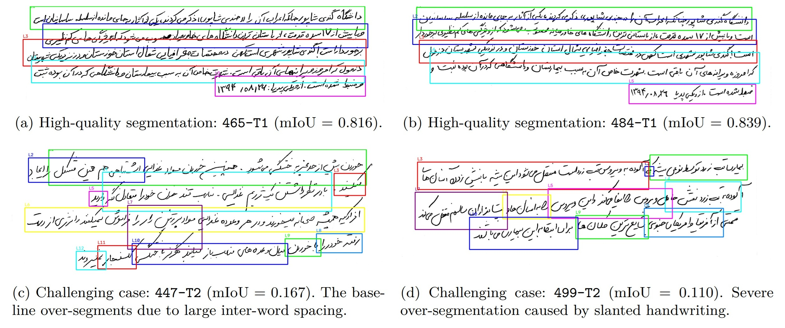

# MPHD Line Segmentation Benchmark

This directory provides the official evaluation scripts to reproduce the Line Segmentation results reported in the MPHD paper (Section 4.2, Table 8, and Figures 6-7). 

The benchmark evaluates an off-the-shelf baseline using **EasyOCR** for word detection combined with a vertical grouping strategy.

---

## Prerequisites
1. Download the MPHD dataset from [Zenodo](https://doi.org/10.5281/zenodo.23557640) and extract it.
2. Ensure you have already generated the official `.ln` split files (`train.ln`, `test.ln`) as described in the step 1.1 and 1.2 of [HTR benchmark section](https://github.com/jampour/MPHD/tree/main/benchmarks/HTR). The test split (`test.ln`) is required for Protocol 2.
3. Install the required Python packages:
   ```bash
   pip install easyocr opencv-python shapely scikit-image matplotlib seaborn scipy
   ```

---

## Step 1: Run the Line Segmentation Evaluation

The script [`line_segmentation_easyocr_benchmark.py`](line_segmentation_easyocr_benchmark.py) supports two protocols:
*   **Protocol 1:** Evaluates on all 500 writers (1,000 images).
*   **Protocol 2:** Evaluates on the official held-out test set (75 writers, 150 images) using `test.ln`.

To run the evaluation:

1. Open the script and update the `DATASET_ROOT` variable to point to your extracted MPHD dataset:
   ```python
   DATASET_ROOT = "../MPHD2/"  # Change this to your actual dataset path
   ```
2. Run the script for **Protocol 1**:
   ```python
   PROTOCOL = 1
   ```
   ```bash
   python line_segmentation_easyocr_benchmark.py
   ```
   *This will generate `evaluation_protocol1.json` and save qualitative visualizations in `visualization_results/`.*

3. Run the script for **Protocol 2**:
   ```python
   PROTOCOL = 2
   ```
   ```bash
   python line_segmentation_easyocr_benchmark.py
   ```
   *This will generate `evaluation_protocol2.json`.*




---

## Step 2: Generate Table 8 Results

To extract the metrics and print the LaTeX table rows for Table 8 in the paper, run:
```bash
python Results_for_Table8.py
```
*This reads the generated JSON files and outputs the metrics (mIoU, F1-scores, LCA, RelCntErr, MeanSSIM) for both protocols.*

---

## Step 3: Generate the IoU Distribution Plot (Figure 7)

To generate the high-resolution histogram and KDE curves comparing the line-level IoU distributions of the two protocols, run:
```bash
python vis_IoU_Hist_Both.py
```
*This will output the statistical summary to the console and save the figure as `protocol_comparison_scientific.png`.*

---

## Reference Results (Table 8)
For reproducibility verification, the expected metrics are approximately:

| Protocol | mIoU(all) | mIoU(m) | F1@0.50 | F1@0.75 | LCA (%) | RelCntErr | MeanSSIM |
| :--- | :--- | :--- | :--- | :--- | :--- | :--- | :--- |
| **Protocol 1** | 0.4354 | 0.6724 | 0.6766 | 0.3813 | 18.40 | 0.5366 | 0.9104 |
| **Protocol 2** | 0.4526 | 0.6789 | 0.7072 | 0.3811 | 25.33 | 0.4857 | 0.9135 |
